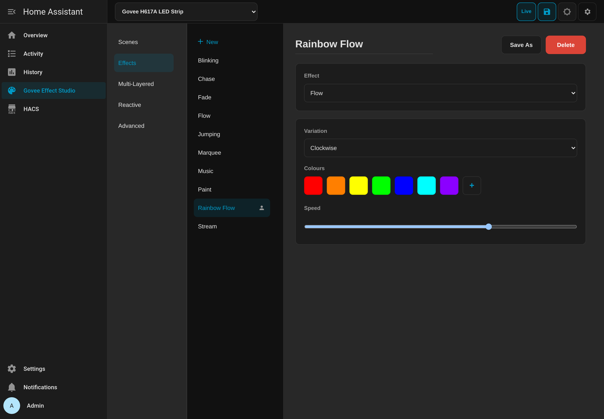
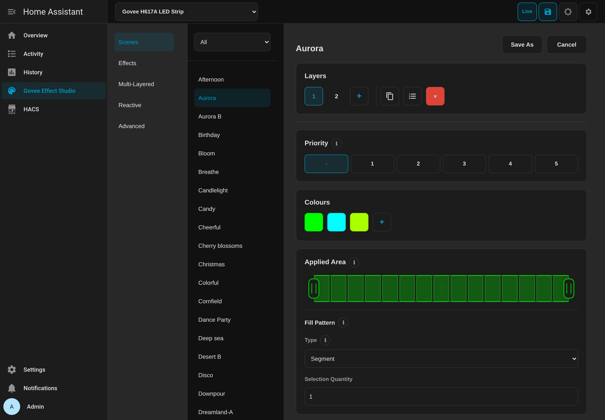

# Govee LED BLE for Home Assistant

[![HACS][hacs-badge]][hacs-url]
[![GitHub Release][release-badge]][release-url]
[![Validate][validate-badge]][validate-url]
[![Home Assistant][ha-badge]][ha-url]

**Govee LED BLE** is a fully local Home Assistant integration for complete control of supported Govee BLE lights—without the cloud.  It connects directly over Bluetooth or through ESPHome Bluetooth proxies, with **Effect Studio** for creating custom effects.

## Device support

| Model | Status |
| --- | --- |
| **H1A42** | ✅ Supported |
| **H1771** | [🚧 Experimental](https://github.com/teh-hippo/ha-govee-led-ble/issues/558) |
| **H600A** | ✅ Supported |
| **H601C** | ✅ Supported |
| **H6046** | ✅ Supported |
| **H605C** | [🚧 Experimental](https://github.com/teh-hippo/ha-govee-led-ble/issues/571) |
| **H6072** | ✅ Supported |
| **H607C** | ✅ Supported |
| **H6076** | ✅ Supported |
| **H6097** | ✅ Supported |
| **H6099** | ✅ Supported |
| **H60A1** | ✅ Supported |
| **H60A6** | ✅ Supported |
| **H60B0** | ✅ Supported |
| **H60B2** | ✅ Supported |
| **H6102** | ✅ Supported |
| **H6117** | [🚧 Experimental](https://github.com/teh-hippo/ha-govee-led-ble/issues/537) |
| **H6125** | ✅ Supported |
| **H6179** | [🚧 Experimental](https://github.com/teh-hippo/ha-govee-led-ble/issues/448) |
| **H617A** | ✅ Supported |
| **H617C** | ✅ Supported |
| **H617E** | ✅ Supported |
| **H617F** | ✅ Supported |
| **H6181** | [🚧 Experimental](https://github.com/teh-hippo/ha-govee-led-ble/issues/580) |
| **H619A** | [🚧 Experimental](https://github.com/teh-hippo/ha-govee-led-ble/issues/567) |
| **H6199** | ✅ Supported |
| **H61F5** | ✅ Supported |
| **H66A0** | ✅ Supported |
| **H7020** | ✅ Supported |
| **H7025** | [🚧 Experimental](https://github.com/teh-hippo/ha-govee-led-ble/issues/451) |
| **H705A** | [🚧 Experimental](https://github.com/teh-hippo/ha-govee-led-ble/issues/607) |

To request another model or suggest a device-specific fix, see [CONTRIBUTING.md](CONTRIBUTING.md).

## Effect Studio

Effect Studio is a Home Assistant sidebar panel that gives you full control of supported devices' effect capabilities.  Explore built-in scenes, create custom effects with colours and layers, tune music and camera/video settings, and preview changes live before saving.  The panel shows the controls available for your device.





## Installation

### HACS (recommended)

[](https://my.home-assistant.io/redirect/hacs_repository/?owner=teh-hippo&repository=ha-govee-led-ble&category=integration)

1. Open **HACS** in Home Assistant and search for **Govee LED BLE**.
2. Download **Govee LED BLE** and restart Home Assistant.
3. Supported lights are discovered automatically over Bluetooth, or can be added via **Settings → Devices & Services → Add Integration → Govee LED BLE**.

### Manual

Download `ha_govee_led_ble.zip` from the [latest GitHub release][release-url], extract it into `config/custom_components/ha_govee_led_ble/`, and restart Home Assistant.

## Development

```bash
make build
make check
make package
```

See [CONTRIBUTING.md](CONTRIBUTING.md) for architecture, repository non-goals and development commands.

## License

MIT

[hacs-badge]: https://img.shields.io/badge/HACS-Default-41BDF5.svg
[hacs-url]: https://github.com/hacs/integration
[release-badge]: https://img.shields.io/github/v/release/teh-hippo/ha-govee-led-ble
[release-url]: https://github.com/teh-hippo/ha-govee-led-ble/releases
[validate-badge]: https://img.shields.io/github/actions/workflow/status/teh-hippo/ha-govee-led-ble/validate.yml?branch=master&label=validate
[validate-url]: https://github.com/teh-hippo/ha-govee-led-ble/actions/workflows/validate.yml
[ha-badge]: https://img.shields.io/badge/HA-2026.9%2B-blue.svg
[ha-url]: https://www.home-assistant.io
