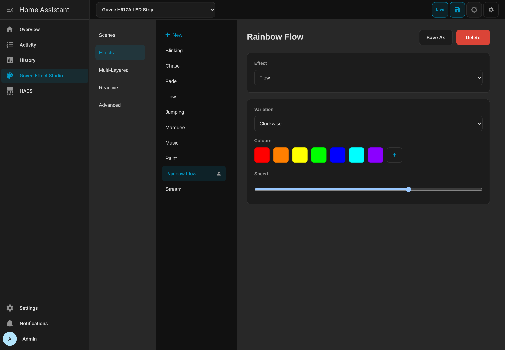
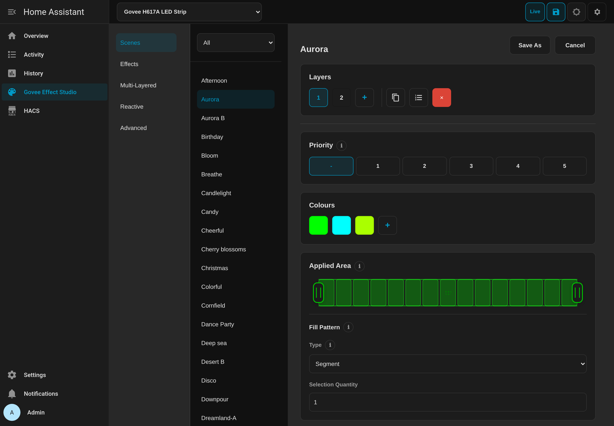

# Govee LED BLE for Home Assistant

[![HACS][hacs-badge]][hacs-url]
[![GitHub Release][release-badge]][release-url]
[![Validate][validate-badge]][validate-url]
[![Home Assistant][ha-badge]][ha-url]

Most Govee integrations rely on rate-limited cloud APIs, require developer keys, or only expose basic on/off and single-colour control over Bluetooth.  **Govee LED BLE** runs 100% locally over Bluetooth (including ESPHome proxies) with full state readback, per-segment RGB and colour temperature, onboard microphone music modes, camera and video settings, and **Effect Studio** for authoring and saving custom effects in Home Assistant.

Each device protocol is captured in [Kaitai Struct](https://kaitai.io/) (`.ksy`) schemas as the single source of truth, powering a shared compatibility layer across all supported models.

## Device support

| Model | Status | Owner evidence or confirmation thread |
| --- | --- | --- |
| **H1A42** | ✅ Supported | [Owner results](https://github.com/teh-hippo/ha-govee-led-ble/issues/429) |
| **H601C** | ✅ Supported | [Corrected owner results](https://github.com/teh-hippo/ha-govee-led-ble/issues/329#issuecomment-6117023962) |
| **H6076** | ✅ Supported | [Owner results](https://github.com/teh-hippo/ha-govee-led-ble/issues/247#issuecomment-5482287413) |
| **H6097** | 🚧 Experimental | [Awaiting confirmation](https://github.com/teh-hippo/ha-govee-led-ble/issues/445) |
| **H6099** | ✅ Supported | [Owner results](https://github.com/teh-hippo/ha-govee-led-ble/issues/258#issuecomment-5703821314) |
| **H60A1** | ✅ Supported | [Owner results](https://github.com/teh-hippo/ha-govee-led-ble/issues/339#issuecomment-6125571117) |
| **H60A6** | ✅ Supported | [Owner results](https://github.com/teh-hippo/ha-govee-led-ble/issues/339#issuecomment-6125571117) |
| **H6102** | ✅ Supported | [Owner results](https://github.com/teh-hippo/ha-govee-led-ble/issues/310#issuecomment-6369891853) |
| **H6125** | ✅ Supported | [Owner results](https://github.com/teh-hippo/ha-govee-led-ble/issues/117#issuecomment-6308131348) |
| **H6179** | 🚧 Experimental | [Awaiting confirmation](https://github.com/teh-hippo/ha-govee-led-ble/issues/448) |
| **H617A** | ✅ Supported | [Maintainer hardware validation](https://github.com/teh-hippo/ha-govee-led-ble/issues/97#issuecomment-4934291245) |
| **H617C** | ✅ Supported | [Owner contribution](https://github.com/teh-hippo/ha-govee-led-ble/pull/331) |
| **H617E** | ✅ Supported | [Owner hardware validation](https://github.com/teh-hippo/ha-govee-led-ble/pull/137) |
| **H617F** | ✅ Supported | [Owner contribution](https://github.com/teh-hippo/ha-govee-led-ble/pull/331) |
| **H6199** | ✅ Supported | [Maintainer hardware validation](https://github.com/teh-hippo/ha-govee-led-ble/issues/97#issuecomment-4934291245) |
| **H61F5** | ✅ Supported | [Owner results](https://github.com/teh-hippo/ha-govee-led-ble/issues/429#issuecomment-6379396864) |
| **H66A0** | ✅ Supported | [Owner results](https://github.com/teh-hippo/ha-govee-led-ble/issues/429) |
| **H7020** | ✅ Supported | [Owner hardware validation](https://github.com/teh-hippo/ha-govee-led-ble/pull/363) |
| **H7025** | 🚧 Experimental | [Awaiting BLE confirmation](https://github.com/teh-hippo/ha-govee-led-ble/issues/451) |

Supported means an owner, including the maintainer, has confirmed working controls on the exact model, not that every feature or hardware/firmware revision has been tested.
The linked reports describe what was tested and any limitations.  Known failures remain separate bug reports, including [Kelvin confirmation on H1A42, H61F5 and H66A0](https://github.com/teh-hippo/ha-govee-led-ble/issues/429).

Experimental models await owner confirmation on actual hardware.
Share your exact model, hardware, firmware, integration version and results in the model's existing [confirmation thread](https://github.com/teh-hippo/ha-govee-led-ble/issues/442), rather than opening another issue.
Maintainers review the evidence and deliver Supported status in an integration release; submitting feedback or hiding its notice does not change that status.
Confirmed model threads may be closed but still accept comments about other revisions.
See the [support lifecycle and issue-creation process](CONTRIBUTING.md#support-lifecycle).

To request support for another model or contribute protocol schemas, see [CONTRIBUTING.md](CONTRIBUTING.md).

## Effect Studio

Effect Studio adds a dedicated panel to the Home Assistant sidebar for lights that support scenes, custom DIY effects, reactive music modes, or camera video profiles.  Administrators can browse exact-SKU scene catalogues, customise palettes and layers, tune onboard microphone or camera settings, and preview changes live on the light before saving.

Saved effects are stored in Home Assistant and exposed directly through the standard `light` entity effect selector for use in dashboards, scripts, and automations.  Non-admin users can browse scenes and saved effects in read-only mode.

Experimental devices show a compact **Experimental**, **Feedback** and **Hide** row.
Their native Home Assistant device information also marks the model as Experimental while retaining the exact SKU and the Studio configuration link.
The Feedback dialog displays the observed model, hardware and firmware, and prepares a report to copy into the model's existing [owner-confirmation issue](https://github.com/teh-hippo/ha-govee-led-ble/issues/442).
Sharing is voluntary; nothing is uploaded automatically and no controls depend on reporting.
**Hide** dismisses the Studio notice for that light for the current tab/app-view session, including across page reloads.
To hide it across sessions for all users of that light, turn off **Show experimental feedback notice** in its integration options.  The native device's Experimental status is unchanged.
New Experimental devices also show setup guidance linking to their existing confirmation issue; there is no report or feedback requirement during setup.
Fill missing versions from the Govee app and identify that source.  Review diagnostics before attaching them because GitHub comments and attachments are public.

H60A1 and H60A6 include their exact-model scene catalogues and DIY effects.  H60A6 also supports native layered effects and 133-point paint, with independent **Panel enabled** and **Ring enabled** switches and a **Power-on behaviour** select.  These additional entities are hidden by default; enabling a zone does not switch on master power.  Newly added ceiling-light effect and setting paths still need owner confirmation on hardware.

The `ha_govee_led_ble.paint_segments` action accepts `rgb_scale` from 0 to 100, applied once to the unscaled RGB groups supplied in that request.  Zero paints black rather than switching power off.  This is static RGB composition, not native ring brightness; retained RGB cannot safely recover native-white intent after a disconnect, so no separate ring-scale number is exposed.





## DreamView

On compatible revisions, H6097, H6099, H6199 and H66A0 expose DreamView group actions separately from the backlight's standalone video effects.
H6097 and H6099 support up to seven members; H66A0 supports up to ten.  Set both DreamView choices explicitly:

```yaml
action: ha_govee_led_ble.set_dreamview_video_settings
target:
  entity_id: light.tv_backlight
data:
  apply_area: part
  content_mode: movie
```

`apply_area` accepts `all` or `part`; `content_mode` accepts `game` or `movie`.  Neither field has a default, and this action does not change group membership.

**DreamView Game/Movie is not the light's `Video: Game` / `Video: Movie` effect.**  Selecting a standalone video effect can switch off a running DreamView group.  You do not need to select that effect before enabling DreamView.

H6199 uses its own legacy group protocol and a candidate limit of five members.  Same brightness additionally requires main hardware 3.02.01 or newer and firmware 1.09.00 or newer, confirmed on the current connection.  Other group controls remain available if version queries time out, provided the advertised Pact is supported.

H6199 group replacement and deletion require a matching device acceptance reply before Home Assistant releases member ownership.  An attempted upload is not retried automatically.  A failed or unanswered change retains private recovery intent and member claims; do not assume that the old hardware group is unchanged.  `read_dreamview_group` separates locally authored metadata from anonymous device observations, and reports identity-gated reads in `unavailable_reads`.  Acceptance does not confirm membership or visible synchronisation.  These new H6199 group paths still need owner qualification.

### Govee-managed setup and API control

Configure group membership and area assignments in Govee, then use the existing Home Assistant actions for control.  No Studio grouping interface is required.

1. Disable any member lights' integration entries in Home Assistant before grouping them, not just their light entities.  A member accepts only one BLE connection.
   If Home Assistant holds the centre's connection, temporarily disable its entry while configuring it in Govee too.
2. Set up the group in Govee, then disconnect the app's BLE session and re-enable the centre's Home Assistant entry.  Leave member entries disabled while the centre controls them.
3. Use DreamView actions for synchronisation and settings.  You do not need to call `replace_dreamview_group` or select a standalone Video effect first.

Switching synchronisation off does not restore disabled member entries.  Before returning members to independent Home Assistant control, release them from the group in Govee.
The integration only automatically restores entries it tracked and disabled itself; an app-created group does not populate that ownership journal.
`replace_dreamview_group` and `delete_dreamview_group` remain advanced, explicit membership changes, not setup steps for ordinary group control.

These actions also work through Home Assistant's [authenticated REST API](https://contributors.home-assistant.io/core/internals/rest-api/#post-apiservicesdomainservice).
For example, enable synchronisation:

```bash
curl --request POST \
  --header "Authorization: Bearer <ACCESS_TOKEN>" \
  --header "Content-Type: application/json" \
  --data '{"entity_id": "light.tv_backlight", "enabled": true}' \
  "<HA_URL>/api/services/ha_govee_led_ble/set_dreamview_switch"
```

To select Part/Movie, send the same headers to
`POST <HA_URL>/api/services/ha_govee_led_ble/set_dreamview_video_settings` with:

```json
{"entity_id": "light.tv_backlight", "apply_area": "part", "content_mode": "movie"}
```

For fresh group observations, use
`POST <HA_URL>/api/services/ha_govee_led_ble/read_dreamview_group?return_response` with:

```json
{"entity_id": "light.tv_backlight"}
```

Read results are under `service_response`.  The read action requires `?return_response`; adding it to a write action, or omitting it from this read, returns HTTP 400.
Locally authored metadata may be absent for an app-created group.  Anonymous connection/brightness slots do not identify members, and missing replies are not proof of an empty group.
Per-member actions need a known slot index.  Do not share unredacted response data, which can contain privately supplied member identities.

### Migrating existing actions and templates

Replace calls to `ha_govee_led_ble.set_dreamview_sample`:

```yaml
# Old
action: ha_govee_led_ble.set_dreamview_sample
target:
  entity_id: light.tv_backlight
data:
  sample_first: 1
  sample_second: 1
```

Use `set_dreamview_video_settings` as shown above, translating both fields:

| Old field | Old value | New field | New value |
| --- | --- | --- | --- |
| `sample_first` | `0` | `apply_area` | `all` |
| `sample_first` | `1` | `apply_area` | `part` |
| `sample_second` | `0` | `content_mode` | `game` |
| `sample_second` | `1` | `content_mode` | `movie` |

For responses from `read_dreamview_group`, replace `observed.sample.sample_first` with `observed.video_settings.apply_area` and `observed.sample.sample_second` with `observed.video_settings.content_mode`.  Update comparisons too: known values are now names, for example `== "part"` rather than `== 1`.  Unrecognised reply values remain their original integers, and `unknown` retains trailing bytes.  An absent reply still produces no observation.

The old action, numeric `observed.sample` response and `sample` entries in `missing_reads` / `unsupported_reads` remain temporarily available.  Those lists include both `sample` and `video_settings` when applicable, so update templates that compare whole lists.  There are no duplicate device queries.

Calling the old action raises a Repairs warning with this migration guide.  Update automations, scripts, dashboards and response templates before the compatibility paths are removed in a separate breaking release, planned for roughly two weeks after the migration release becomes available.  Templates using old response fields cannot be detected automatically.  The old action still accepts raw byte values, but values outside `0`/`1` have no supported named equivalent; do not guess a replacement.

## Installation

### HACS (recommended)

[](https://my.home-assistant.io/redirect/hacs_repository/?owner=teh-hippo&repository=ha-govee-led-ble&category=integration)

1. Open **HACS** in Home Assistant and search for **Govee LED BLE**.
2. Download **Govee LED BLE** and restart Home Assistant.
3. Supported lights are discovered automatically over Bluetooth, or can be added via **Settings → Devices & Services → Add Integration → Govee LED BLE**.

### Manual

Download `ha_govee_led_ble.zip` from the [latest GitHub release][release-url], extract it into `config/custom_components/ha_govee_led_ble/`, and restart Home Assistant.

## Development

```bash
make build
make check
make package
```

See [CONTRIBUTING.md](CONTRIBUTING.md) for architecture, Kaitai protocol schemas, repository non-goals, and validation rules.

## License

MIT

[hacs-badge]: https://img.shields.io/badge/HACS-Default-41BDF5.svg
[hacs-url]: https://github.com/hacs/integration
[release-badge]: https://img.shields.io/github/v/release/teh-hippo/ha-govee-led-ble
[release-url]: https://github.com/teh-hippo/ha-govee-led-ble/releases
[validate-badge]: https://img.shields.io/github/actions/workflow/status/teh-hippo/ha-govee-led-ble/validate.yml?branch=master&label=validate
[validate-url]: https://github.com/teh-hippo/ha-govee-led-ble/actions/workflows/validate.yml
[ha-badge]: https://img.shields.io/badge/HA-2026.9%2B-blue.svg
[ha-url]: https://www.home-assistant.io
