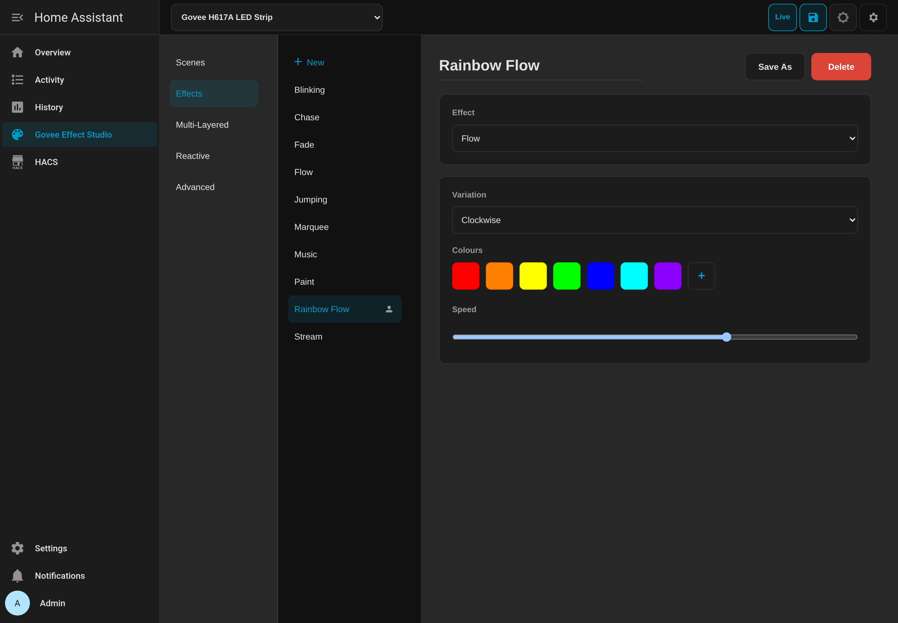
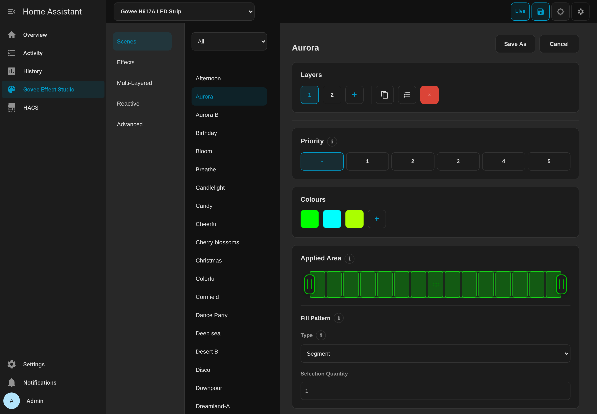

# Govee LED BLE for Home Assistant

[![HACS][hacs-badge]][hacs-url]
[![GitHub Release][release-badge]][release-url]
[![Validate][validate-badge]][validate-url]
[![Home Assistant][ha-badge]][ha-url]

**Govee LED BLE** provides fully local Home Assistant control of supported Govee BLE lights.
Connect over Bluetooth or ESPHome Bluetooth proxies, and create custom effects with **Effect Studio**.

## Device support

| Model | Status |
| --- | --- |
| **H1A42** | ✅ Supported |
| **H1771** | ✅ Supported |
| **H600A** | ✅ Supported |
| **H601C** | ✅ Supported |
| **H6022** | [🚧 Experimental](https://github.com/teh-hippo/ha-govee-led-ble/issues/622) |
| **H6046** | ✅ Supported |
| **H6053** | [🚧 Experimental](https://github.com/teh-hippo/ha-govee-led-ble/issues/662) |
| **H605C** | ✅ Supported |
| **H6072** | ✅ Supported |
| **H607C** | ✅ Supported |
| **H6076** | ✅ Supported |
| **H6093** | [🚧 Experimental](https://github.com/teh-hippo/ha-govee-led-ble/issues/623) |
| **H6097** | ✅ Supported |
| **H6099** | ✅ Supported |
| **H60A1** | ✅ Supported |
| **H60A6** | ✅ Supported |
| **H60B0** | ✅ Supported |
| **H60B2** | ✅ Supported |
| **H6102** | ✅ Supported |
| **H6117** | [🚧 Experimental](https://github.com/teh-hippo/ha-govee-led-ble/issues/537) |
| **H612A** | [🚧 Experimental](https://github.com/teh-hippo/ha-govee-led-ble/issues/687) |
| **H6125** | ✅ Supported |
| **H6127** | [🚧 Experimental](https://github.com/teh-hippo/ha-govee-led-ble/issues/634) |
| **H6139** | [🚧 Experimental](https://github.com/teh-hippo/ha-govee-led-ble/issues/705) |
| **H6159** | ✅ Supported |
| **H6179** | [🚧 Experimental](https://github.com/teh-hippo/ha-govee-led-ble/issues/448) |
| **H617A** | ✅ Supported |
| **H617C** | ✅ Supported |
| **H617E** | ✅ Supported |
| **H617F** | ✅ Supported |
| **H618A** | ✅ Supported |
| **H6181** | ✅ Supported |
| **H6182** | ✅ Supported |
| **H619A** | [🚧 Experimental](https://github.com/teh-hippo/ha-govee-led-ble/issues/567) |
| **H6199** | ✅ Supported |
| **H61F5** | ✅ Supported |
| **H1AB2** | ✅ Supported |
| **H66A0** | ✅ Supported |
| **H8604** | [🚧 Experimental](https://github.com/teh-hippo/ha-govee-led-ble/issues/688) |
| **H7020** | ✅ Supported |
| **H7025** | [🚧 Experimental](https://github.com/teh-hippo/ha-govee-led-ble/issues/451) |
| **H705A** | [🚧 Experimental](https://github.com/teh-hippo/ha-govee-led-ble/issues/596) |

To request another model or suggest a device-specific fix, see [CONTRIBUTING.md](CONTRIBUTING.md).

## Effect Studio

Effect Studio is a Home Assistant sidebar panel showing your device's available effect controls.
Explore built-in scenes, create effects with colours and layers, tune music and camera/video settings, and preview changes live before saving.

Effects require a recoverable static layout before starting.
Normal release-mode idle disconnects retain that history, with identity and layout checked again before reuse.
Effect off restores that original layout, including different area and segment colours, even after switching between effects.
If recovery state is unavailable, including after restarting while an effect is running, establish a complete static colour and brightness layout through the integration first.
Write-only devices can use successfully delivered static controls.
Live effect selections retain extra readback requirements for source layouts and configurable segments; Apply remains available for complete write-only layouts.
Disabling Live or closing the editor stops further Live changes without undoing completed changes.
Restoring a previously off light may briefly illuminate it before turning it off again.

H6093 uses its own projector controls, scenes and DIY formats.
**Initialise projector lighting** establishes a missing projector appearance.
It turns the light on at full master brightness, sets both aurora patterns blue and sets the stars to 50% with flicker and movement off.
This replaces the current lighting settings and establishes a complete recovery baseline.
Later controller revisions retain completed native writes as delivered state.
Live preview requires observed appearance.
Aurora movement controls physical motion separately from pattern speed.
A single-colour palette does not demonstrate colour-flow speed; test Fade, Breathe or Flash, or use multiple colours in Effect Studio.
Create and save projector DIY in Effect Studio.
Local sound playback pauses or resumes the selected sound; Local sound mode controls device-wide sound enablement.

Choose **Canvas** to paint native logical segments and save complete colour compositions for recall.
New canvases and **Clear all** set every segment Off (black), so you can paint only the segments you want lit and save the complete layout.
Compositions store only RGB colours and their input scale.
Apply them through ordinary static controls.





## Installation

### HACS (recommended)

[](https://my.home-assistant.io/redirect/hacs_repository/?owner=teh-hippo&repository=ha-govee-led-ble&category=integration)

1. Open **HACS** in Home Assistant and search for **Govee LED BLE**.
2. Download **Govee LED BLE** and restart Home Assistant.
3. Supported lights are discovered automatically over Bluetooth, or can be added via **Settings → Devices & Services → Add Integration → Govee LED BLE**.

### Manual

Download `ha_govee_led_ble.zip` from the [latest GitHub release][release-url], extract it into `config/custom_components/ha_govee_led_ble/`, and restart Home Assistant.

## Development

Native development is the default.
Install [mise](https://mise.jdx.dev/getting-started.html), then run:

```bash
make bootstrap
```

Use the narrowest relevant loop while editing:

```bash
uv run pytest tests/test_coordinator_status.py -q
npm --prefix frontend run dev
npm --prefix frontend run typecheck
npm --prefix frontend run test:unit
make protocol
```

Run `make check-fast` for a broad checkpoint and `make check` at the completion boundary.
Run `make package` only when a distributable is explicitly required.
The optional dev container is a thin wrapper around the same project-local bootstrap, not a separate toolchain.

See [CONTRIBUTING.md](CONTRIBUTING.md) for architecture, repository non-goals and acceptance requirements.

## License

MIT

[hacs-badge]: https://img.shields.io/badge/HACS-Default-41BDF5.svg
[hacs-url]: https://github.com/hacs/integration
[release-badge]: https://img.shields.io/github/v/release/teh-hippo/ha-govee-led-ble
[release-url]: https://github.com/teh-hippo/ha-govee-led-ble/releases
[validate-badge]: https://img.shields.io/github/actions/workflow/status/teh-hippo/ha-govee-led-ble/validate.yml?branch=master&label=validate
[validate-url]: https://github.com/teh-hippo/ha-govee-led-ble/actions/workflows/validate.yml
[ha-badge]: https://img.shields.io/badge/HA-2026.9%2B-blue.svg
[ha-url]: https://www.home-assistant.io
